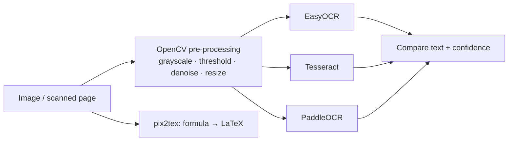

# 👁️ BRIHA · Multi-Engine OCR Text Extraction


     

> ⚡ **Part of [BRIHA](https://github.com/asad110abbas)** · Briha Research, built by Syed Asad Abbas.

Compares **three OCR engines side by side** (EasyOCR, Tesseract and PaddleOCR) on the same images, with
OpenCV pre-processing to improve accuracy. It also converts math formulas to LaTeX with **pix2tex**.

## Pipeline


## Highlights
- **3 engines, one notebook:** pick the best engine per document type
- **Pre-processing** with OpenCV and PIL for noisy scans
- **Visual inspection** with bounding boxes drawn using Matplotlib
- **Math OCR:** image of an equation → LaTeX (pix2tex)

## Run
```bash
pip install easyocr pytesseract paddleocr opencv-python pillow matplotlib pix2tex
```
Install the Tesseract binary for your OS, then open `OCR_Text Extraction.ipynb`.
